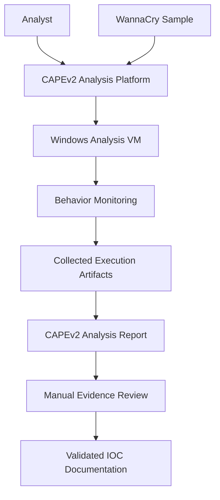
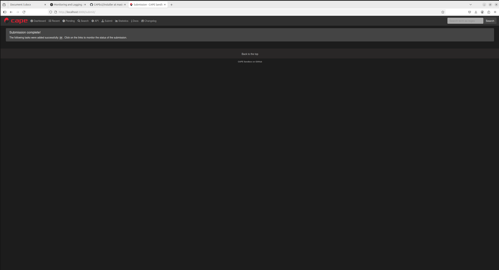
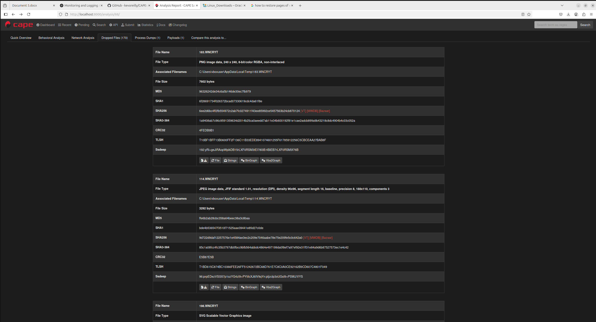
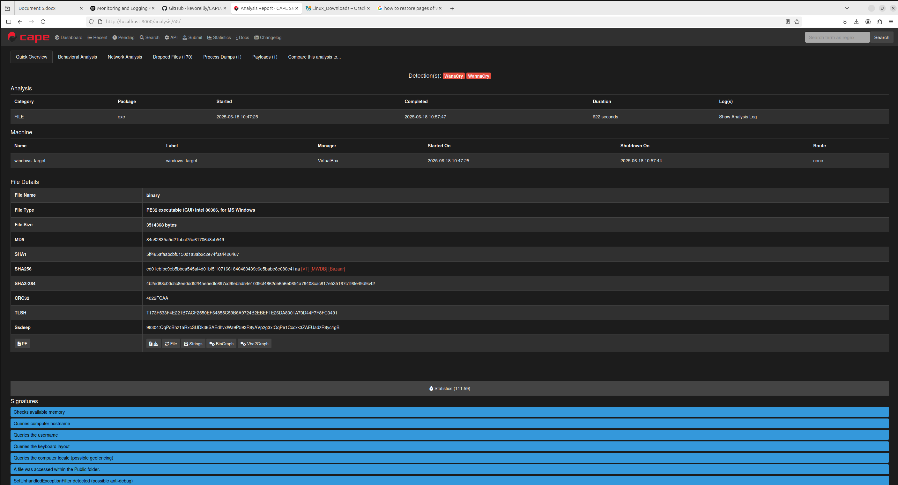

# 🦠 WannaCry Malware Analysis with CAPEv2

> **Cybersecurity / DFIR Project:** A dynamic malware-analysis case study using CAPEv2 to investigate WannaCry ransomware behavior in a virtualized Windows environment, review execution artifacts, and document indicators of compromise (IOCs) for defensive analysis.

## 📖 Overview

This project documents a hands-on malware-analysis exercise using the
[CAPE Automated Malware Analysis system (CAPEv2)](https://github.com/kevoreilly/CAPEv2).

The objective was to examine the behavior of a WannaCry ransomware sample
in a controlled virtual-machine environment and review the evidence produced
by the sandbox.

The analysis workflow focuses on:

- Observing process execution and relationships.
- Reviewing filesystem activity and artifacts.
- Examining registry changes reported during execution.
- Reviewing sandbox-generated behavioral reports.
- Identifying potential indicators of compromise (IOCs).
- Documenting findings and the limitations of the collected evidence.

The project demonstrates practical exposure to malware detonation workflows,
sandbox operation, behavioral analysis, and forensic artifact review.

**Scope note:** Findings from a sandbox run are specific to the sample and
environment tested. The absence of observed behavior does not prove that
the behavior cannot occur under different conditions.

## 🎯 Objectives

1. Operate a CAPEv2 analysis environment with a Windows guest.
2. Submit a malware sample to the sandbox for controlled analysis.
3. Review execution artifacts and behavioral reports.
4. Identify potentially relevant process, filesystem, and registry activity.
5. Document defensible IOCs with traceable supporting evidence.
6. Understand the limitations of automated malware-analysis results.

## 🏗️ Architecture

*This diagram illustrates the analysis workflow. It does not represent
a verified inventory of all enabled CAPEv2 monitoring components.*

## 🧰 Technology Stack

| Component | Purpose |
|---|---|
| CAPEv2 | Automated malware-analysis and sandbox platform |
| Ubuntu Linux | Host environment for the analysis platform |
| Windows 10 VM | Guest environment used for sample execution |
| CAPE guest agent | Communication between the guest and analysis platform |
| Python | CAPEv2 tooling and supporting scripts |
| CAPEv2 Web Interface | Sample submission and report review |
| Behavioral reports | Evidence collection and forensic triage |

Refer to [`SETUP.md`](SETUP.md) for the environment notes.

The exact host OS release, hypervisor version, and virtual-network configuration
should be kept consistent across the setup documentation and the actual lab.

## 🔄 Analysis Workflow

### 1. Prepare the Analysis Environment

Prepare the CAPEv2 host and a dedicated Windows analysis VM.

Before submitting a suspicious executable, verify the isolation boundary,
guest-to-host restrictions, snapshot/recovery procedure, and network-routing
configuration.

The analysis VM should not have unrestricted access to the host network,
production systems, personal accounts, or sensitive data.

### 2. Submit the Sample

Submit the sample through the CAPEv2 interface or an appropriate submission
utility configured for the lab.

Record the sample's SHA-256 hash and the analysis task identifier where
available. Use a verified sample source and document its provenance when known.

The malware executable itself should not be committed to this repository.

### 3. Observe Execution

Review the sandbox results for evidence such as:

- Process creation and process relationships.
- Files created, modified, or dropped during execution.
- Registry operations.
- Relevant API activity and execution behavior.
- Network-related indicators reported by the sandbox, where available.

Each finding should be supported by an identifiable report, log, screenshot,
or other collected artifact.

### 4. Review the Evidence

Examine the analysis report and distinguish direct observations from
interpretations.

A process name, file path, registry event, or network indicator should not
automatically be labelled malicious without sufficient context.

Record the source of each important finding so another analyst can reproduce
or independently review the conclusion.

### 5. Document IOCs

A useful IOC summary should contain only indicators supported by the collected
evidence.

Recommended fields include:

| Field | Description |
|---|---|
| Indicator type | File hash, file path, registry key, domain, IP address, or other indicator |
| Indicator value | The exact observed value |
| Evidence source | Report, log, process event, or artifact supporting the finding |
| Context | What the indicator represents in this analysis |
| Confidence | Confidence in the interpretation and its supporting evidence |

The current repository does not link to a dedicated IOC summary file.
Add a sanitized, evidence-backed IOC report once the findings have been
verified and the report has been committed.

Do not invent indicators or present unverified values as observed facts.

## 📊 Demonstration and Screenshots

### Recorded Analysis Demonstration

[▶ Watch the WannaCry analysis demonstration on YouTube](https://youtu.be/LHIFQqk9zLk)

### Sample Submission

### Analysis Results

*These images document selected stages of the analysis. They are not a
substitute for the underlying forensic evidence or a complete case report.*

If a screenshot does not render, verify its filename and capitalization
against the files in the `report/` directory. GitHub paths are case-sensitive.

## 🔍 Evidence and Findings

The purpose of the analysis was to review sandbox-generated evidence of
sample execution and identify potentially useful behavioral indicators.

The relevant categories for review include:

- **Process activity:** execution sequence and process relationships.
- **Filesystem activity:** created or modified files and other artifacts.
- **Registry activity:** observed registry operations and their context.
- **Behavioral evidence:** API activity and other sandbox observations.
- **Potential IOCs:** indicators supported by specific collected artifacts.

A separate, sanitized IOC summary should be linked here once the actual
findings have been reviewed and documented.

### Network Evidence Limitations

No external packet capture using a tool such as Wireshark was recorded for
the documented analysis run.

Network-related conclusions must therefore remain limited to evidence
actually available in the CAPEv2 reports and logs. The project does not claim
independently verified packet-level network findings for this run.

## 🛡️ Malware-Analysis Safety

Malware analysis must be performed only in an authorized, controlled lab.

Recommended safeguards include:

- Use a dedicated, disposable guest VM.
- Verify isolation and routing rules before each analysis.
- Disable unnecessary host–guest integration, including shared clipboard
  and unrestricted shared folders.
- Take a clean snapshot and restore it after testing.
- Keep analysis samples away from production systems and personal data.
- Do not expose the analysis guest or management interface to untrusted networks.
- Follow CAPEv2's current installation and security documentation.
- Use the appropriate dedicated service account; do not run all CAPEv2
  components as root.
- Never publish live malware samples or sensitive analysis-environment
  credentials in the repository.

**Important:** Host-only, NAT, and routed sandbox networking have different
security and analysis implications. Configure networking deliberately for
the chosen CAPEv2 machinery and containment requirements. Do not assume that
a particular network mode is safe without verifying its actual routing and
connectivity.

For current installation requirements and configuration guidance, consult
the [official CAPEv2 repository](https://github.com/kevoreilly/CAPEv2) and
[CAPEv2 documentation](https://capev2.readthedocs.io/).

## ⚙️ Environment Setup

Project-specific setup notes are available in [`SETUP.md`](SETUP.md).

The setup guide should document the exact environment used for the recorded
analysis, including:

- Host operating-system release.
- Hypervisor and guest-machine configuration.
- Windows guest architecture and CAPE agent setup.
- CAPEv2 version or Git commit.
- Virtual networking and containment controls.
- Sample submission procedure.
- Report and artifact locations.
- Recovery and cleanup procedure.

**Reproducibility note:** Verify these details against the environment that
was actually used. Keep `README.md` and `SETUP.md` consistent, and use the
official CAPEv2 documentation for version-specific installation commands.

## 🎓 Skills Demonstrated

- Dynamic malware-analysis workflow.
- CAPEv2 sandbox operation and report review.
- Windows execution-artifact triage.
- Process, filesystem, and registry evidence review.
- IOC identification and documentation methodology.
- Basic forensic evidence attribution and confidence assessment.
- Virtualized lab operation and containment awareness.
- Technical documentation for defensive security investigations.

## 🚧 Limitations and Future Improvements

Potential improvements to this project include:

- Publishing a sanitized IOC summary linked to supporting evidence.
- Recording the exact host, hypervisor, and CAPEv2 versions.
- Documenting the network-isolation design and validating containment.
- Adding a concise investigation timeline.
- Including relevant screenshots of process, filesystem, and registry artifacts.
- Documenting sample provenance and cryptographic hashes where appropriate.
- Separating direct observations from analyst interpretation.
- Adding a repeatable checklist for reviewing sandbox reports.
- Explaining which behaviors were observed and which could not be confirmed.

These improvements would make the investigation easier to reproduce and
the conclusions easier for another analyst to validate.

## 📚 References

- [CAPEv2 — Official Repository](https://github.com/kevoreilly/CAPEv2)
- [CAPEv2 — Official Documentation](https://capev2.readthedocs.io/)
- [CAPEv2 — Analysis Results Documentation](https://capev2.readthedocs.io/en/latest/usage/results.html)

## 📝 Acknowledgments

This project was developed as a hands-on cybersecurity and digital-forensics
learning exercise.

Thanks to the CAPEv2 project contributors for maintaining the open-source
malware-analysis platform used in this investigation.

## 📬 Contact

For feedback or professional inquiries:

- **Email:** husele1000@gmail.com
- **GitHub:** [Chinkhuselts](https://github.com/Chinkhuselts)
